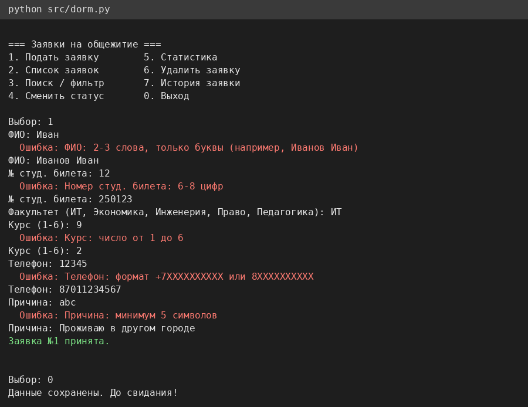
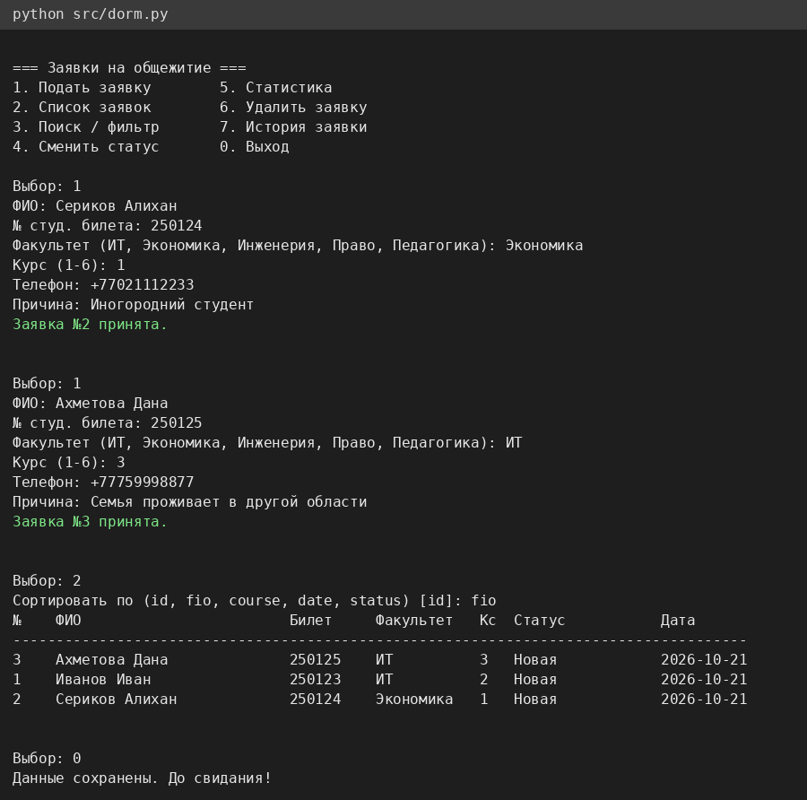
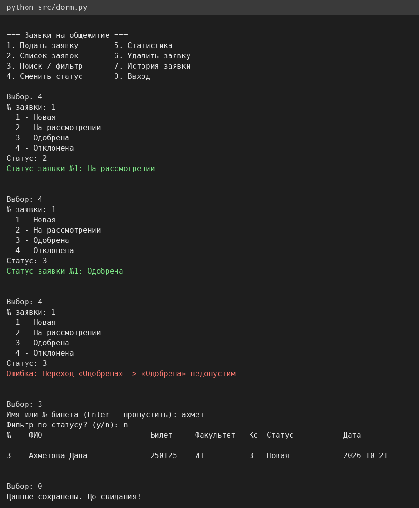
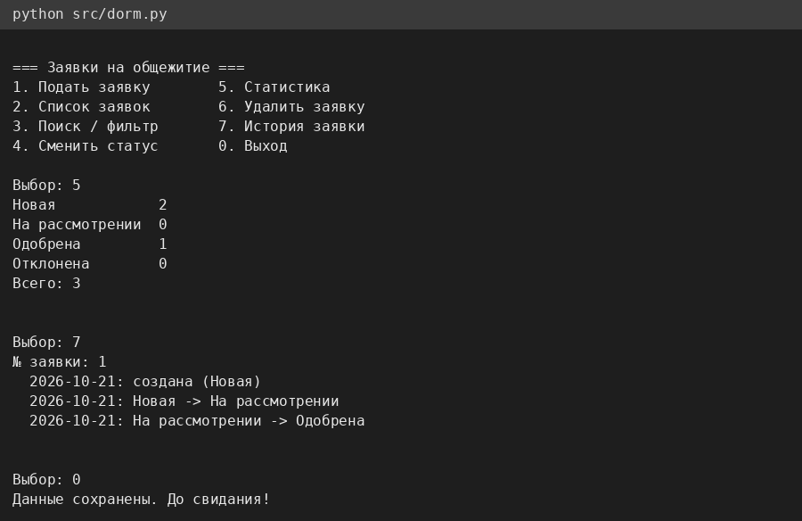

# Система учета заявок на общежитие

Мини-проект СРО по дисциплине «Языки и технология программирования», тема 20.

| | |
|---|---|
| **Автор** | Дюсембаев Дамир, группа ИС 25-22 |
| **Версия** | 1.0 (21.10.2026) |
| **Язык / стек** | Python 3.8+, только стандартная библиотека |
| **Презентация** | `presentation/presentation.pptx` |

## 1. Цель, проблема, аудитория
**Цель:** автоматизировать приём и обработку заявок студентов на проживание в общежитии.

**Проблема:** при ручном учёте (бумага, общая таблица) заявки теряются, данные вносятся с ошибками, возникают дубли, а статус и история решений не прослеживаются. Потребность большая: по данным, озвученным на заседании фракции Respublica в мажилисе, из 678 тыс. студентов Казахстана 364,5 тыс. иногородние [3].

**Аудитория:** студенты (подают заявку), сотрудники деканата и коменданты (рассматривают, ищут, сортируют, меняют статус).

## 2. Анализ предметной области и аналоги
| Аналог | Что делает | Ограничения для нашей задачи |
|---|---|---|
| Единая заявка на портале eGov.kz [1][2] | Онлайн-подача заявки на место, отслеживание статуса; нужен номер телефона в базе мобильных граждан и согласие на обработку персональных данных | Государственный сервис, вуз не управляет внутренним учётом и сортировкой |
| Платформа UniDorm 2.0 (обсуждалась в мажилисе) [3] | Выбор комнаты онлайн, очередь, свободные места, проверка документов льготников | Масштабная платформа, требует инфраструктуры |
| Platonus (личный кабинет студента) [4] | Единая система вуза с кабинетами студентов и сотрудников; заявку на общежитие подают онлайн или лично | Универсальная система, отдельный модуль заявок гибко не настраивается |
| Ручной учёт / вузовский приём заявлений [5] | Приём заявлений в вузах по очередности, соцположению и конкурсу | Нет автоматической проверки данных, поиска и истории |

**Вывод:** нужен лёгкий инструмент для вуза с проверкой ввода, контролем жизненного цикла заявки, поиском и сортировкой.

**Источники**
1. inbusiness.kz. «В Казахстане упростили подачу заявок на места в общежитиях для студентов колледжей» — https://inbusiness.kz/ru/news/v-kazahstane-uprostili-podachu-zayavok-na-mesta-v-obshezhitiyah-dlya-studentov-kolledzhej
2. nur.kz. «Как получить место в общежитии через онлайн-услуги в Казахстане» — https://www.nur.kz/nurfin/personal/2104944-kak-poluchit-mesto-v-obshchezhitii-studentam-cherez-onlayn-uslugi-v-kazahstane/
3. BES.media. «Студентам в Казахстане хотят разрешить выбирать места в общежитиях онлайн» — https://bes.media/news/studentam-v-kazahstane-hotyat-razreshit-vibirat-mesta-v-obshezhitiyah-onlayn/
4. Informburo.kz. «Гид для студента первого курса: общежитие, GPA и Platonus» — https://informburo.kz/kaz/kogam/birinsi-kurs-studentine-arnalgan-gaid-zataqxana-gpa-zane-platonus-zuiesi
5. Univision.kz. «Общежития в ВУЗах Казахстана» — https://univision.kz/granty/1219-obshchezhitiya-v-vuzah-kazahstana.html

## 3. Функциональные возможности
1. Подача заявки с проверкой всех полей: ФИО, № студенческого билета (6–8 цифр), факультет, курс (1–6), телефон (+7 / 8), причина (5–200 символов).
2. Список заявок с сортировкой по id, ФИО, курсу, дате, статусу.
3. Поиск по ФИО или номеру билета, фильтр по статусу и факультету.
4. Смена статуса по правилам: Новая → На рассмотрении → Одобрена / Отклонена (Новая → Отклонена тоже допустимо).
5. История изменений заявки, статистика по статусам, удаление.
6. Запрет второй активной заявки у одного студента; сохранение в JSON.

**Ограничения:** консольный интерфейс; нет авторизации и ролей; данные хранятся в локальном JSON-файле; один пользователь одновременно.

## 4. Стек, архитектура, структура файлов
```
dorm-applications/
├── README.md
├── src/dorm.py                # валидация, модель, логика, хранилище, консольное меню
├── tests/
│   ├── test_dorm.py           # 16 автотестов (unittest)
│   ├── run_protocol.py        # запуск и формирование протокола
│   ├── protocol.md            # протокол тестирования
│   └── test_run.log           # вывод unittest
├── docs/
│   ├── analysis_requirements.md
│   └── make_screenshots.py    # генерация скриншотов из реального запуска
├── screenshots/               # 4 скриншота интерфейса
├── presentation/              # presentation.pptx, build.js
└── .gitignore
```
Слои: валидаторы → `Application` (dataclass) и `Status` (Enum) → `DormRegistry` (add, search, sort, change_status, stats, delete, save/load) → JSON → консольное меню `main()`.

## 5. Установка и запуск
Требуется Python 3.8 или новее, внешние пакеты не нужны.
```bash
git clone <ссылка-на-репозиторий>
cd dorm-applications
python src/dorm.py                 # запуск приложения
python tests/test_dorm.py          # автотесты
python tests/run_protocol.py       # тесты + протокол в tests/protocol.md
```
Данные сохраняются в `applications.json` (создаётся при первом запуске, в репозиторий не попадает).

## 6. Примеры использования
Подача заявки с повторным вводом при ошибках:



Список с сортировкой по ФИО:



Смена статуса, блокировка недопустимого перехода, поиск:



Статистика и история заявки:



## 7. Тестирование
Методика: модульные автотесты `unittest` (5 основных сценариев, 4 ошибочного ввода, 3 граничных, 4 регрессионных после исследовательского тестирования).

Дата: 21.10.2026. Окружение: Python 3.12.3, Linux.
Команда: `python tests/run_protocol.py`

| ID | Сценарий | Ожидаемо | Фактически | Статус |
|---|---|---|---|---|
| T-01 | Добавить корректную заявку | Заявка в списке, id=1, статус «Новая» | Заявка в списке, id=1, статус «Новая» | PASS |
| T-02 | Новая → На рассмотрении → Одобрена | Статус «Одобрена», 3 записи истории | Статус «Одобрена», 3 записи истории | PASS |
| T-03 | Поиск по ФИО, по номеру билета, фильтр по факультету | Находится ровно 1 заявка в каждом случае | Находится ровно 1 заявка в каждом случае | PASS |
| T-04 | Сортировка по ФИО и по курсу (убывание) | ФИО: Агаев, Иванов; курсы: 3, 1 | ФИО: Агаев, Иванов; курсы: 3, 1 | PASS |
| T-05 | Сохранение в JSON, загрузка, статистика | Данные восстановлены, «Новая» = 1 | Данные восстановлены, «Новая» = 1 | PASS |
| T-06 | Пустое ФИО | ValidationError, заявка не создана | ValidationError, заявка не создана | PASS |
| T-07 | Телефон «12345» | ValidationError | ValidationError | PASS |
| T-08 | Переход Новая → Одобрена минуя рассмотрение | ValidationError, статус не изменился | ValidationError, статус не изменился | PASS |
| T-09 | Вторая активная заявка того же студента | ValidationError | ValidationError | PASS |
| T-10 | Курс 1 и 6 принимаются, 0 и 7 нет | Границы 1..6 соблюдены | Границы 1..6 соблюдены | PASS |
| T-11 | Причина 5 и 200 символов принимается, 4 и 201 нет | Границы 5..200 соблюдены | Границы 5..200 соблюдены | PASS |
| T-12 | Пустой реестр: поиск, статистика, get(1) | [], нули, KeyError | [], нули, KeyError | PASS |
| T-13 | ФИО из одних дефисов «- -» и «-Иван- Иванов» (дефект D1) | ValidationError; «Иванов-Петров Иван» принимается | ValidationError; «Иванов-Петров Иван» принимается | PASS |
| T-14 | Номер билета арабскими цифрами «٢٥٠١٢٣» (дефект D2) | ValidationError | ValidationError | PASS |
| T-15 | Курс True (дефект D3) | ValidationError | ValidationError | PASS |
| T-16 | Конец ввода (Ctrl+D) в меню (дефект D4) | Программа сохраняет данные и завершается без traceback | Программа сохраняет данные и завершается без traceback | PASS |

Итого: 16 из 16 PASS.

Дополнительно выполнена ручная проверка через консоль (скриншоты в разделе 6).

## 8. Обнаруженные дефекты и исправления
| № | Дефект | Как найден | Исправление | Тест |
|---|---|---|---|---|
| D1 | ФИО из одних дефисов («- -», «-Иван- Иванов») проходило проверку | Исследовательское тестирование валидации | Регулярное выражение: дефис допустим только между буквами | T-13 |
| D2 | Номер билета принимал нелатинские цифры (арабские «٢٥٠١٢٣») | То же | Проверка `[0-9]` вместо `\d` (также для телефона) | T-14 |
| D3 | Курс `True` принимался как 1 (при вызове из кода) | То же | Явный отказ для типа `bool` | T-15 |
| D4 | Конец ввода (Ctrl+D) приводил к аварийному завершению с traceback | Запуск с пустым вводом | Перехват `EOFError`/`KeyboardInterrupt`, сохранение данных | T-16 |

**Оставшиеся ограничения:** нет ролей и авторизации; нет блокировки файла при одновременной работе нескольких пользователей; нет проверки номера билета по внешней базе.

## 9. Авторы и версия
Дюсембаев Дамир, ИС 25-22 (индивидуальная работа). Версия 1.0, 21.10.2026.
